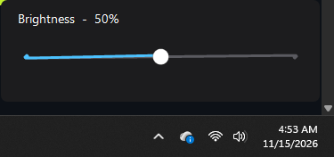

# Brightness Control — Windows 10/11

Brightness slider for **external monitors** — lives in your taskbar tray. No internet access, fully local app that controls brightness over DDC/CI.

## Requirements (Zaroori Cheezein)

- Windows 10 ya Windows 11
  - (Windows 7/8.1 ho to pehle .NET Framework 4.8 install karna hoga — Microsoft site se)
- Monitor HDMI/DP/VGA cable se connected ho
- Monitor **DDC/CI** support karta ho (99% modern monitors karte hain)
  - Agar brightness change nahi hoti to monitor ke OSD menu mein "DDC/CI" setting dhundo aur ON karo

## Install (bas 2 minute)

1. Ye PURA folder USB pendrive / OneDrive / email se naye PC par copy karo
2. `install.bat` par **DOUBLE-CLICK** karo
3. BAS! Ho gaya — taskbar mein sun (☀) icon aa jayega

## App Kaise Use Karein

| Action | Result |
|---|---|
| Sun icon par LEFT-click | Brightness slider khulega |
| `Ctrl+Alt+B` | Slider open/close |
| `Ctrl+Alt+Shift` + Up/Down | Brightness +5% / −5% |
| Sun icon par RIGHT-click | 25% / 50% / 75% / 100% quick set |
| `Esc` ya kahin aur click | Slider band |

## Important Notes

- App Windows ke saath **AUTO-START** hoti hai (restart ke baad bhi kaam karegi)
- Ye app **EXTERNAL MONITOR** ke liye hai. Laptop ke apni screen ka slider Windows mein pehle se hota hai.
- Koi antivirus warn kare to "Allow" kar dena — ye safe local app hai (koi internet access nahi karti)

## Uninstall

- `uninstall.bat` par double-click karo
  - (app + auto-start + shortcuts sab clean remove ho jayenge)

## Technical Details (zaroorat pade to)

- App ki asli location: `%LOCALAPPDATA%\BrightnessControl\BrightnessTray.exe`
- Brightness DDC/CI (VCP code 0x10) ke through control hoti hai
- Debug log: usi folder mein `brightness.log` banta hai
